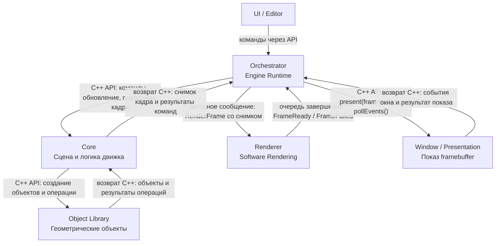

# Общая архитектура собственного графического движка

Подробные предлагаемые контракты, способы общения, потоки выполнения и анализ
рисков: [Взаимодействие подсистем](subsystem_interaction.md).

## 2. Схема компонентов

## 3. Компоненты

### UI / Editor

UI — внешний пользовательский интерфейс движка и редактора сцены.
Он отвечает за создание и удаление объектов, изменение их параметров, управление камерой и отображение текущего состояния сцены.
UI не должен самостоятельно выполнять геометрические вычисления или рендеринг, а только формировать команды для движка.
Взаимодействие с внутренними компонентами происходит через публичный API и слой `Orchestrator`.
Конкретная технология интерфейса может быть заменена без изменения основной архитектуры движка.

### Orchestrator

`Orchestrator` является управляющим слоем движка и связывает между собой остальные подсистемы.
Он принимает команды от UI, определяет необходимую последовательность действий и передаёт управление соответствующим компонентам.
Также этот слой отвечает за жизненный цикл приложения: инициализацию, обновление состояния, запуск рендера кадра и завершение работы.
Оркестратор не должен содержать собственную геометрию или алгоритмы растеризации — его задача состоит именно в координации.
В реализации этот компонент может быть представлен классом `Engine`, `EngineRuntime` или набором системных сервисов.

### Object Library

`Object Library` — обычная C++-библиотека, содержащая классы геометрических объектов и операции над ними.
В библиотеке могут находиться точки, линии, кривые, полигоны, сеточные модели и составные объекты.
Объекты хранят свои параметры; через API библиотеки можно выполнять операции над геометрией и подготавливать примитивы для отображения.
Библиотека не отвечает за отображение объектов на экране и не должна зависеть от UI.
Библиотека не является актором и не владеет сценой. Core вызывает её API и владеет созданными экземплярами; идентификаторы, иерархия и жизненный цикл объектов сцены относятся к Core.

### Core

`Core` является центральной частью движка и хранит логическое состояние сцены.
Здесь находятся объекты сцены, их взаимное расположение, преобразования, камера, иерархия и другие данные, необходимые для работы движка.
Core принимает изменения состояния через оркестратор и возвращает ему неизменяемый снимок для построения кадра. Внутренняя часть Render Preparation собирает этот снимок, используя операции Object Library.
В Core находится логика пространственных отношений в сцене. Общие математические типы следует вынести в нижележащий модуль, доступный также Object Library без зависимости от Core.
Core не должен знать о деталях пользовательского интерфейса и конкретном способе вывода изображения на экран.

### Renderer

`Renderer` отвечает за преобразование состояния сцены в итоговое изображение.
В рамках проекта это собственный программный рендерер, поэтому основные этапы графического конвейера реализуются алгоритмами внутри движка, а не передаются готовому 3D API.
Renderer получает геометрию и параметры камеры в сообщении RenderFrame от оркестратора, выполняет необходимые преобразования и формирует содержимое framebuffer. Он не читает изменяемые объекты Core. Акторный адаптер доставляет задания и возвращает завершения в главный поток.
Он не должен заниматься созданием объектов, обработкой пользовательских действий или хранением логики сцены.
Результатом работы Renderer является готовый двумерный буфер изображения, который можно вывести в окно любым подходящим способом.

### Framebuffer и Window / Presentation

Framebuffer — буфер данных изображения, а Window / Presentation — адаптер его показа и системных событий.
Renderer записывает цвет итоговых пикселей в принадлежащий заданию framebuffer и передаёт готовый буфер оркестратору через FrameReady. Оркестратор вызывает оконный адаптер для показа в главном потоке.
Оконный слой может также предоставлять базовые системные события, такие как изменение размера окна или ввод с клавиатуры и мыши.
При этом он не участвует в построении геометрии, вычислении перспективы или других алгоритмах рендеринга.
Такое разделение позволяет сохранить собственный графический конвейер независимо от используемой GUI- или оконной библиотеки.

## 4. Поток данных

В типичном сценарии пользователь выполняет действие в UI, после чего команда передаётся в `Orchestrator`.
Оркестратор передаёт команду в `Core`; Core вызывает API `Object Library` и изменяет состояние сцены.
После применения команд и обновления мира оркестратор запрашивает у Core снимок кадра и отправляет его Renderer акторным сообщением. Снимок удерживает нужные ресурсы и не меняется во время рендеринга. В первой реализации допускается одно незавершённое задание кадра.
Renderer формирует framebuffer и возвращает его сообщением FrameReady. Оркестратор обрабатывает завершение в главном потоке и передаёт буфер оконному адаптеру для отображения.
Таким образом, интерфейс, логика сцены и алгоритмы рендеринга остаются разделёнными и могут развиваться независимо друг от друга.
