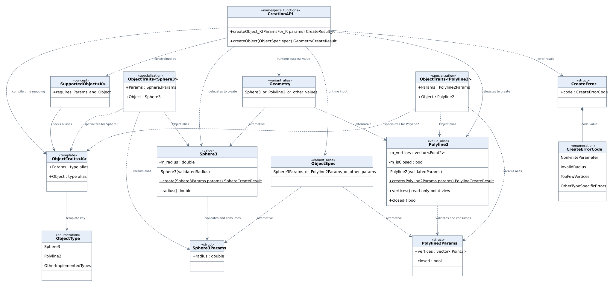
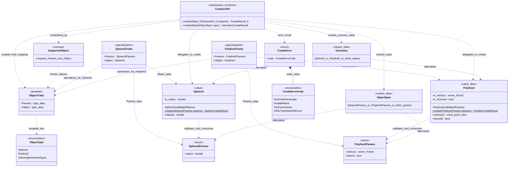
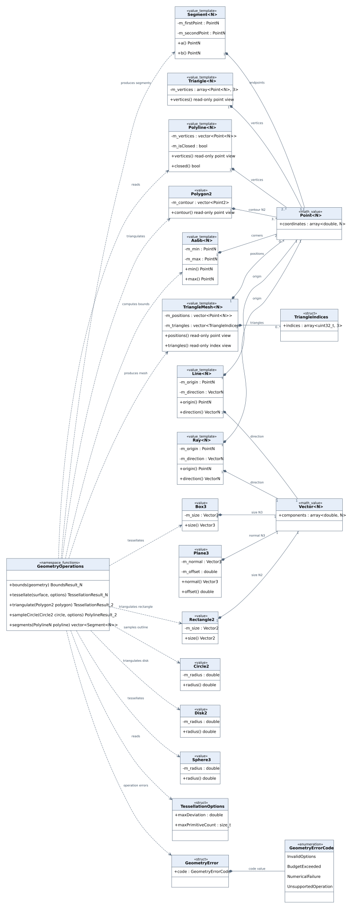
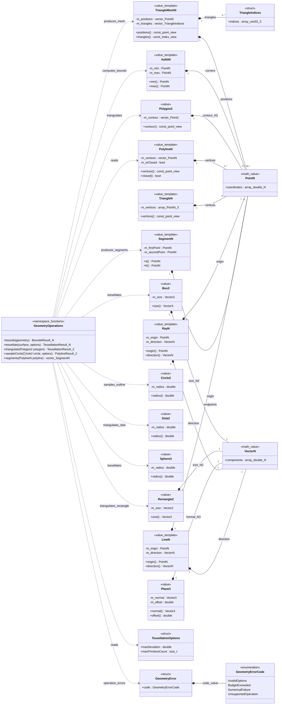
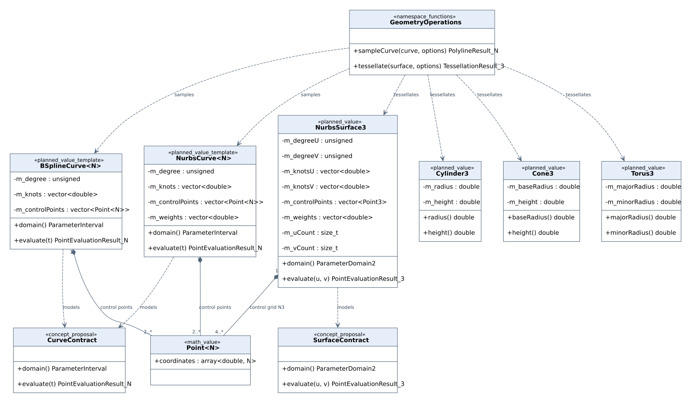
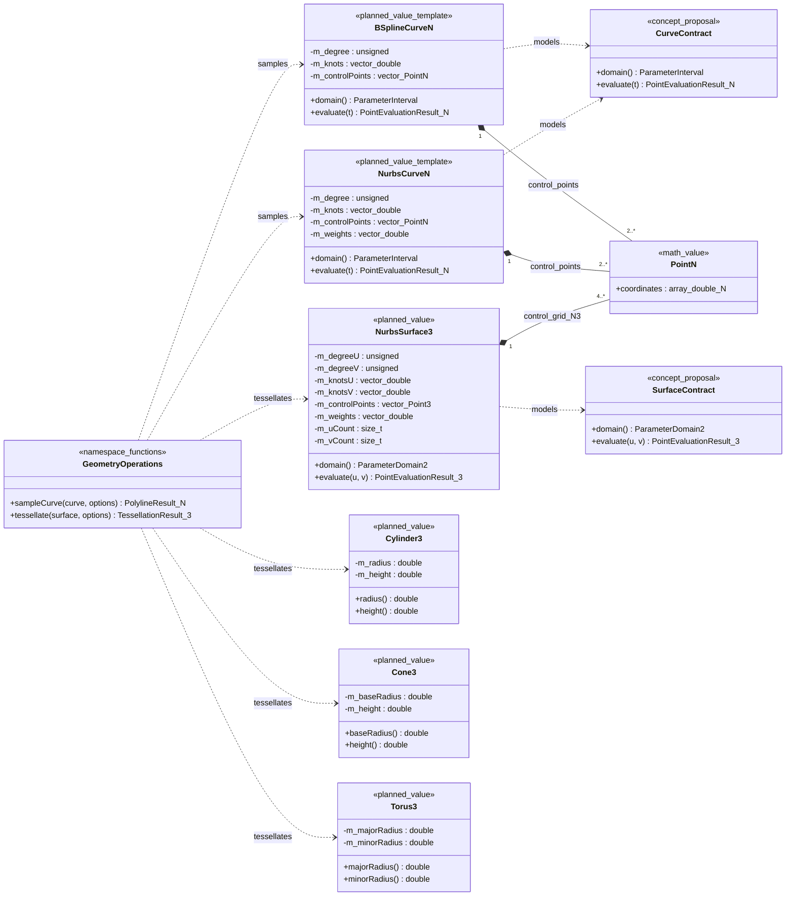

# Object Library: UML-диаграммы классов

Статус: базовая модель реализована; расширения третьего представления остаются
следующим этапом. [Использование реализации](objectlib_usage.md).
Последовательность проектирования: `senior-architect` —
границы, зависимости и состав типов; `software-design-review` — создание,
владение, инварианты и возможности расширения. Основа —
[принятый API создания](objectlib_creation_api.md) и [каталог объектов](objects.md).

Модель разделена на три представления одной библиотеки: создание, базовая
геометрия и дальнейшее расширение. Первые два задают направление реализации,
третье описывает последующие возможности и не входит в обязательный первый этап.

## 1. Обозначения и решения

- `+` — публичный член, `-` — закрытое поле; подчёркнутые операции статические.
- Пунктирная стрелка — зависимость; чёрный ромб — владение вложенными значениями.
  В этих представлениях отношения наследования отсутствуют.
- `N` ограничен значениями 2 и 3. Например, `PolylineN` обозначает C++-шаблон
  `Polyline<N>`, его публичные имена — `Polyline2` и `Polyline3`.
- `CreateResult<T>` обозначает `std::expected<T, CreateError>`,
  `TessellationResult<N>` — `std::expected<TriangleMesh<N>, GeometryError>`.
  `BoundsResult<N>` — `std::expected<Aabb<N>, GeometryError>`.
  `PolylineResult<N>` — `std::expected<Polyline<N>, GeometryError>`.
  Классами библиотеки эти сокращения не являются.
- `CreationAPI` и `GeometryOperations` — UML-группы свободных функций namespace
  `objectlib`, а не C++-классы с экземплярами. Отдельной фабрики-менеджера нет.
- `ObjectTraits` и `SupportedObject` существуют на этапе компиляции. Стрелка
  `specializes` показывает специализацию шаблона, а не наследование.
- `ObjectSpec` и `Geometry` — алиасы `std::variant`, а не базовые классы. На схеме
  показаны две альтернативы для читаемости; при поддержке новых типов их добавляют
  в каталог, traits и runtime-вход.

## 2. Создание и типобезопасный API



`Sphere3` и `Polyline2` показаны подробно как примеры конкретных классов. Проверка
параметров находится в их статических `create`; оба входа общей фабрики используют
эти операции. Закрытые конструкторы исключают создание обычным вызывающим кодом
объектов с непроверенными параметрами. Копирование и перемещение значений разрешены;
для изменения геометрии создаётся новое проверенное значение.



Имена `createObject_K`, `ParamsFor_K` и `CreateResult_K` — сокращения UML для
шаблонного вызова, а не предлагаемое переименование публичного API:

```cpp
template<ObjectType kind>
    requires SupportedObject<kind>
[[nodiscard]]
auto createObject(typename ObjectTraits<kind>::Params params)
    -> std::expected<typename ObjectTraits<kind>::Object, CreateError>;

auto sphere = createObject<ObjectType::Sphere3>(Sphere3Params{.radius = 2.0});
```

`OtherImplementedTypes` и `OtherTypeSpecificErrors` обозначают пропущенные элементы
каталога, а не реальные значения enum. `GeometryCreateResult` —
`std::expected<Geometry, CreateError>`. Все структуры параметров содержат геометрию;
ни одна не содержит Scene ObjectId, родителя сцены или оконных ресурсов.

## 3. Базовая геометрия 2D и 3D



Общие математические значения `Point<N>` и `Vector<N>` размещаются в Math и
используются через публичные алиасы. Их числовые координаты могут быть произвольными;
геометрические классы проверяют конечность при создании. Общая математика не
получает зависимости на Object Library.

Для каждого проверяемого геометрического типа предполагается `XParams` и
`X::create(XParams) -> CreateResult<X>`. Повторяющиеся структуры параметров,
статические фабрики и конструкторы здесь опущены. Стрелки владения отображают
именно сохранённые данные, а не копии ссылок на объекты Core.



`TriangleMesh<N>` выбран как конкретный начальный вид Mesh: позиции плюс индексы
треугольников, без требования хранить объекты `Triangle<N>`. Материалы не принадлежат
этой модели. Нормали, UV и другие атрибуты можно добавить после определения их
контрактов; обязательными полями первой версии они не объявлены.
TriangleIndices содержит только числовые индексы, ссылающиеся на позиции своей
сетки; зависимости C++-типа TriangleIndices от TriangleMesh нет.

Операции — набор перегрузок для поддерживаемых типов, а не универсальный метод
любого объекта. `bounds` для Line, Ray и Plane не возвращает конечный AABB без
заданной области ограничения; такие перегрузки в начальный набор не входят.
Из полилинии получаются отрезки, из окружности — контур, из диска — заполненная
треугольная сетка. Все эти результаты не являются одним взаимозаменяемым типом.

Ограничение `maxPrimitiveCount` сдерживает объём результата; оно не гарантирует
длительность вычисления. Параметры точности и численной устойчивости должны быть
определены для каждого алгоритма, а не сведены к одному глобальному epsilon.
В первой версии GeometryError содержит код; дополнительный контекст ошибки можно
добавить позже. Исключения выделения памяти сохраняют политику из API создания.

## 4. Кривые, поверхности и расширение каталога



Это последующий этап. Curve и Surface обозначают требования к конкретным типам,
а не обязательную виртуальную иерархию. Связь `models` — удовлетворение контракту.
Превращать эти требования в C++ concepts следует при появлении общих алгоритмов,
которым они действительно нужны.



`PointEvaluationResult<N>` и `PolylineResult<N>` используют GeometryError.
Для кривых нужно согласовать степени, число контрольных точек, длину и порядок
узлов, область параметра; для NURBS — также веса и знаменатель вычисления.
Модель предполагает степень не ниже 1, поэтому показана соответствующая нижняя
граница количества контрольных точек. Математически допустимые постоянные кривые
потребовали бы расширения этого контракта.

У поверхности плоские массивы описывают сетку `uCount × vCount`; размеры массива
точек и весов должны совпадать с произведением. BSpline и NURBS могут использовать
общие внутренние алгоритмы, без отношения наследования между их публичными типами.

## 5. Сопоставление с исходным каталогом

| Исходное имя | Типы в модели / решение |
|---|---|
| Point | Math Point2, Point3; публичные алиасы, при необходимости теги фабрики |
| Line | Line2, Line3 — бесконечные прямые |
| Polyline | Polyline2, Polyline3 |
| Ray | Ray2, Ray3 |
| Plane | Plane3 |
| Polygon | Polygon2; Polygon3 отложен до контракта плоскостности и локального базиса |
| Rectangle | Rectangle2; размещение фигуры в 3D задаёт Core |
| Triangle | Triangle2, Triangle3 |
| Curve | Предлагаемый CurveContract для конкретных видов кривых |
| BSpline | BSplineCurve2, BSplineCurve3 — следующий этап |
| NURBS | NurbsCurve2, NurbsCurve3, NurbsSurface3 — следующий этап |
| Mesh | TriangleMesh2, TriangleMesh3; теги enum следует называть так же |
| Surface | Предлагаемый SurfaceContract для конкретных параметрических поверхностей |
| Sphere | Sphere3 |
| Box | Box3; Aabb2/3 отдельно для ограничивающих объёмов |
| Cylinder | Cylinder3 — следующий этап |
| Cone | Cone3 — следующий этап |
| Torus | Torus3 — следующий этап |
| CompositeObject | Отложен: нужно определить геометрическое объединение, группу либо другую семантику; иерархия сцены уже принадлежит Core |

Дополнены Segment2/3, Circle2, Disk2, Aabb2/3 и Vector2/3. Они устраняют смешение
отрезка с прямой, окружности с заполненным кругом и фигуры с ограничивающим объёмом.

## 6. Инварианты и время жизни

| Семейство | Предлагаемое правило |
|---|---|
| Геометрические значения | Закрытое состояние, проверяемое создание, чтение через getters; преобразование возвращает новое значение |
| Line / Ray | Конечные параметры и ненулевое направление; нормализация не обязательна |
| Segment | Конечные концы; совпадающие концы допустимы, алгоритмы учитывают нулевую длину |
| Triangle | Конечные вершины; коллинеарные / совпадающие вершины отвергаются по предикатам long double |
| Plane | Конечная ненулевая нормаль и конечное смещение в уравнении n·x + d = 0 |
| Polyline | Не менее двух точек, для closed — не менее трёх; самопересечение допустимо |
| Polygon2 | Начальный вариант — простой контур без отверстий; замыкание не требует хранения повторного конца |
| Sphere / Circle / Disk | Конечный положительный радиус; центр локального описания в начале координат |
| Rectangle / Box | Конечные положительные размеры; локальный центр в начале координат, оси совпадают с координатными |
| Aabb | Конечные углы, min ≤ max по каждой координате; нулевой размер допустим |
| TriangleMesh | Все индексы в диапазоне позиций; пустая сетка допустима; численная и топологическая политики задаются отдельно |

Методы, возвращающие const-view, не передают владение. Представление действует
пока жив соответствующий объект и не происходит его перемещение или присваивание;
для асинхронной задачи требуется владение самим объектом / стабильным снимком.
Параллельные чтения допускаются при отсутствии скрытого изменяемого кеша;
кеш тесселяции первоначально находится во внешнем слое подготовки кадра.

Point и Vector как математические агрегаты не обещают эти геометрические
инварианты. Если фабрика принимает координаты для отдельного отображаемого Point,
она проверяет конечность; низкоуровневые математические значения остаются пригодны
для промежуточных вычислений.

## 7. Результат ревью и границы реализации

1. Единого базового Object не требуется: вычислительный луч, сетка и параметрическая
   сфера имеют разные операции. Runtime-каталог выражается через variant.
2. Размерность ограничена и задаётся типом. Polyline2 в первом представлении —
   алиас PolylineN с N=2, а не отдельный наследник.
3. Фабрика не владеет объектами после возврата и не создаёт Scene ObjectId.
   Ни один класс не зависит от Core, Renderer, UI, окна или акторной библиотеки.
4. Сетка получается отдельной операцией. Математическая Sphere3 не хранит второй
   изменяемый источник истины в виде встроенной сетки.
5. Параметры открыты для составления запроса; созданные геометрические классы
   закрывают поля. Другие операции не могут обходить проверяемое создание.
6. Статическая фабрика, runtime-фабрика и будущий async-адаптер используют одни
   проверки. Добавление типа требует синхронного обновления каталога и traits.
7. Расширение сетки атрибутами, CompositeObject, численные допуски и точный набор
   операций требуют отдельных решений. Диаграмма явно оставляет их открытыми.

Реализованы 23 конкретных тега базового каталога, оба входа фабрики и операции
из второго представления. Тесты проверяют несовместимые Params, валидацию,
удержание памяти и эквивалентность статического и runtime-входа. Полные численные
правила и алгоритмы приведены в документе использования.

[PlantUML-исходник всех трёх представлений](objectlib_classes.puml).
SVG показывают ту же модель в виде UML-классов с отделениями для полей и операций.
Это проектные артефакты, а не диаграммы, извлечённые из реализованного C++.

## 8. Файлы и проверка

| Представление | SVG | Исходник Graphviz |
|---|---|---|
| Создание | [objectlib_creation.svg](diagrams/objectlib_creation.svg) | [objectlib_creation.dot](diagrams/objectlib_creation.dot) |
| Базовая геометрия | [objectlib_geometry.svg](diagrams/objectlib_geometry.svg) | [objectlib_geometry.dot](diagrams/objectlib_geometry.dot) |
| Расширения | [objectlib_extensions.svg](diagrams/objectlib_extensions.svg) | [objectlib_extensions.dot](diagrams/objectlib_extensions.dot) |

Mermaid-блоки проверяются грамматикой classDiagram; SVG генерируются локальным
Graphviz по тем же классам, членам и отношениям. Отрисованные изображения проверены
визуально. PlantUML предоставляет альтернативное представление той же модели,
но его исходник не запускался через PlantUML, которого нет в окружении.

Повторная сборка конкретного SVG из корня проекта:

```sh
dot -Tsvg docs/diagrams/objectlib_creation.dot -o docs/diagrams/objectlib_creation.svg
```
