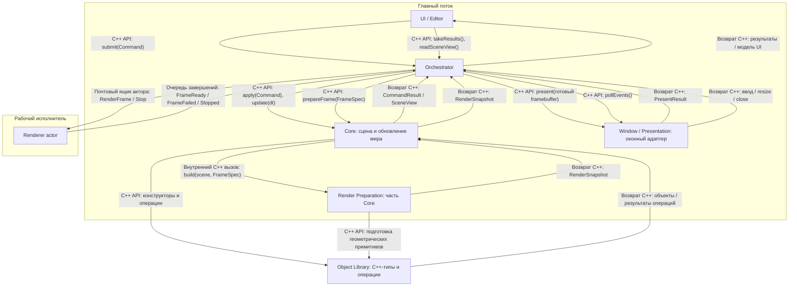
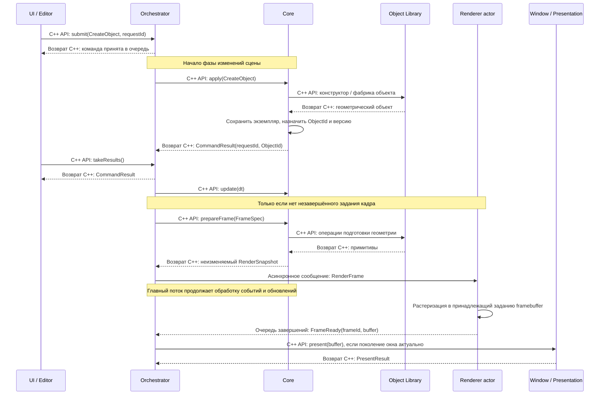
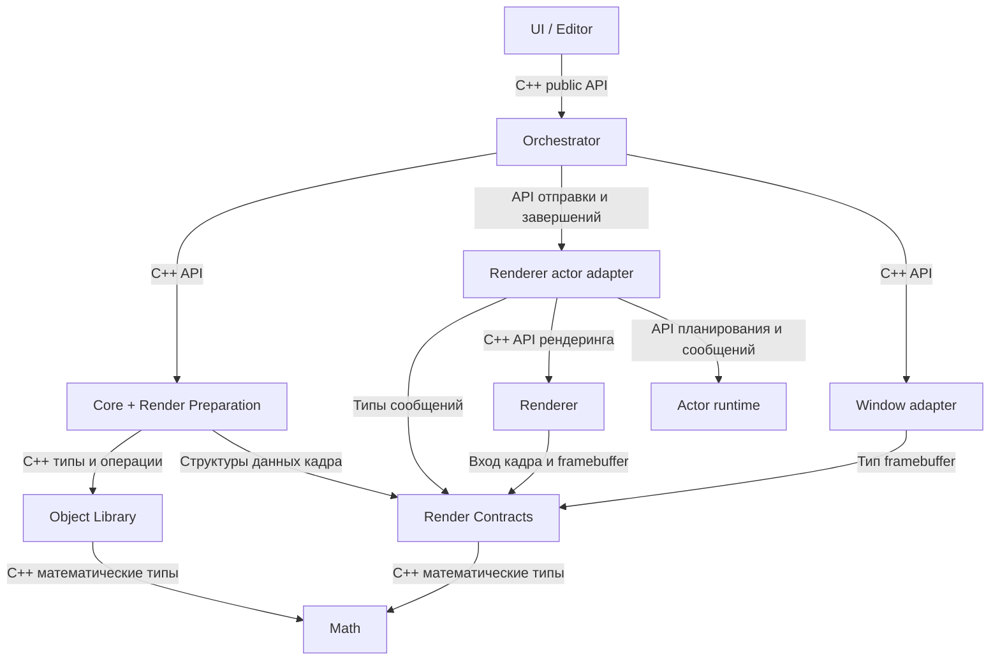

# Huynity: взаимодействие подсистем

Статус: предлагаемая архитектура первой реализации. Документ уточняет
[общий обзор](engine_architecture_overview.md) с учётом того, что Object Library —
обычная C++-библиотека объектов и операций. Её базовая часть уже реализована;
остальные подсистемы остаются проектом. Описанные риски взаимодействия относятся
к проекту, а не к обнаруженным ошибкам исполнения.

Повторное [архитектурное ревью](architecture_review.md) уточняет протокол доставки.
Формальная [UML-диаграмма последовательности](subsystem_interaction_uml.md)
и её [PlantUML-исходник](subsystem_interaction.puml) отражают эти уточнения.

## 1. Основное решение

Использовать синхронные вызовы внутри контура управления сценой и асинхронные
типизированные сообщения на границе с Renderer. Object Library не является
актором, сервисом, владельцем сцены или участником обмена сообщениями.

Core единолично владеет изменяемой сценой. Оркестратор диспетчеризует команды,
управляет фазами и временем жизни подсистем. Renderer получает самостоятельное
задание кадра и не обращается к изменяемому Core. Оконный адаптер показывает
готовый framebuffer и возвращает системные события.

Для начала UI, Orchestrator, Core и оконный адаптер работают в главном потоке.
Renderer — актор с последовательной обработкой заданий на рабочем исполнителе.
Конкретная акторная библиотека ещё не выбрана. Отдельный поток на каждый объект
или каждую подсистему не требуется.

## 2. Диаграмма взаимодействия

Стрелки ниже обозначают вызовы и передачу данных, а не зависимости C++-заголовков.
Каждая связь подписана механизмом общения. Ответы на синхронные вызовы возвращаются
в вызывающий код; только граница Renderer использует асинхронные сообщения.

Очередь завершений — адаптер к главному циклу. Обработчики сообщений Renderer
не вызывают Core, UI и оконную библиотеку из рабочего потока. Главный поток
сам забирает завершения в определённой фазе цикла. Реализация этой очереди
может предоставляться выбранной акторной библиотекой.

## 3. Обязанности и владение

| Подсистема | Владеет / отвечает за | Не отвечает за |
|---|---|---|
| UI / Editor | Состояние интерфейса, выбор объектов по ID, формирование команд | Изменение внутренних объектов Core напрямую |
| Orchestrator | Жизненный цикл, очередь команд, порядок фаз, задания в обработке | Геометрические алгоритмы, растеризацию, игровые правила |
| Core | Объекты сцены, ID, преобразования, иерархию, камеру, обновление мира | Окно, акторную доставку, пиксельный конвейер |
| Object Library | Определения геометрических типов и операции над ними | Глобальную сцену, маршрутизацию, окно и планировщик |
| Render Preparation | Преобразование состояния сцены в данные кадра | Отправку сообщений и рисование пикселей |
| Renderer | Вычисления кадра, временные буферы, запись framebuffer | Чтение изменяемой сцены и обработку редакторских команд |
| Window / Presentation | Окно, системные события, показ изображения | Создание геометрии и симуляцию |

Render Preparation первоначально является внутренней частью Core, а не отдельным
актором. Она собирает преобразования и камеру, вызывает операции Object Library
для подготовки геометрии. Если тесселяция станет дорогой, её можно кешировать
или вынести в фоновые задачи с проверкой версии результата.

Экземпляр сцены и геометрия — разные сущности: несколько экземпляров могут
использовать одну неизменяемую геометрию. Object Library определяет типы;
памятью конкретных экземпляров владеет вызывающая сторона. Scene ObjectId
назначает Core, а не библиотека геометрии.

## 4. Контракты границ

Названия ниже иллюстрируют предлагаемый API и не являются уже существующим кодом.

| Граница | Вход | Ответ и правила |
|---|---|---|
| UI → Orchestrator | `Command{requestId, payload}` | `submit` подтверждает постановку в очередь, а не выполнение; окончательный результат содержит тот же `requestId` |
| Orchestrator → Core | `apply(Command)` | Синхронный `CommandResult`: ID / новая версия сцены либо ошибка; невалидная команда не меняет сцену частично |
| Orchestrator → Core | `update(dt)` | Обновляет мир в выделенной фазе; фиксированный настраиваемый шаг `h`, с ограничением догоняющих обновлений |
| Orchestrator → Core | `prepareFrame(FrameSpec)` | Неизменяемый `RenderSnapshot` либо ошибка подготовки; акторной отправки внутри нет |
| Orchestrator → Renderer | `RenderFrame{frameId, surfaceGeneration, snapshot}` | Асинхронно; адаптер `trySubmit` возвращает Accepted / Rejected; при штатно работающем исполнителе одно принятое задание даёт одно `FrameReady` или `FrameFailed` |
| Renderer → Orchestrator | `FrameReady{frameId, surfaceGeneration, buffer}` | Передаёт владение готовым framebuffer; Renderer больше не изменяет его |
| Renderer → Orchestrator | `FrameFailed{frameId, error}` | Освобождает слот задания; сцена остаётся действительной, ошибка видна UI |
| Orchestrator → Window | `present(buffer)` | Для первой версии синхронно потребляет / копирует пиксели, не сохраняет ссылку после возврата; иначе нужен отдельный сигнал окончания использования |

`RenderSnapshot` содержит версию сцены, камеру, размеры изображения, параметры
очистки и список поддерживаемых примитивов с преобразованиями. Начальный набор
примитивов можно ограничить точками, отрезками и треугольниками. Параметрические
объекты преобразуются в этот набор до отправки. Для бесконечных объектов из
[списка геометрии](objects.md) нужно отдельно задать конечную область визуализации;
не каждый математический объект обязан быть отображаемым.

Снимок не содержит указателей на изменяемые элементы Core. В первой реализации
допустимо владение всеми данными снимка; оптимизация — совместное владение
неизменяемыми блоками геометрии. При изменении блока создаётся новая версия:
одного `shared_ptr<const T>` недостаточно, если где-то сохранена изменяемая ссылка.
Удаление объекта из сцены не освобождает ресурсы, нужные уже отправленному кадру.

ObjectId должен обнаруживать устаревшее обращение: например, через индекс и
поколение слота. Команды с недействительным ID возвращают ошибку. Иерархия
не допускает циклов; правила удаления потомков фиксируются в API Core.

## 5. Создание объекта и построение кадра

Одна команда создания не требует отдельного кадра. Несколько команд применяются
до подготовки общего снимка. Renderer получает полное описание отображаемого
состояния, а не только новый объект; постоянная реплика сцены в Renderer не нужна.

Framebuffer — тип данных с пикселями, размерами, шагом строки и форматом, а не
активная подсистема. Renderer формирует кадр непосредственно в нём. Буфер глубины
может оставаться внутренним ресурсом Renderer. Window выполняет показ или
копирование в собственный буфер оконной системы.

## 6. Очереди, resize и завершение

- **Ограничение кадров:** максимум одно незавершённое задание Renderer. Пока оно
  выполняется, Core может изменяться, но новые снимки не накапливаются. После
  завершения формируется снимок актуальной сцены. Это ограничивает очередь,
  но не гарантирует предельное время рендеринга.
- **Команды:** очередь имеет заданный предел; при заполнении `submit` явно
  возвращает отказ. Принятые команды не теряются молча. Применение идёт в порядке
  приёма на главном потоке. Для будущих внешних отправителей понадобится отдельная
  политика порядка; акторная доставка сама по себе не задаёт детерминизм симуляции.
- **Resize:** Orchestrator увеличивает `surfaceGeneration`. Завершённый кадр
  старого поколения освобождается без показа; следующий получает новые размеры.
  При нулевой площади окна новые задания не отправляются.
- **Ошибка:** ошибка команды оставляет сцену согласованной; ошибка подготовки
  не отправляет кадр; `FrameFailed` снимает признак занятости. Ошибку показа
  обрабатывает Orchestrator, сохраняя владение ресурсами до безопасного освобождения.
- **Сбой исполнителя:** мониторинг актора сообщает о его завершении отдельно от
  `FrameFailed`. После такого сбоя новые кадры не отправляются до явного
  восстановления или завершения приложения. Таймаут сам по себе не разрешает
  освобождать память, которую ещё может использовать рабочий поток.
- **Завершение:** прекратить приём новых команд и кадров, завершить принятые
  команды или вернуть им явную отмену, дождаться исхода текущего кадра, отправить
  `Stop`, получить `Stopped` и дождаться остановки исполнителя. Затем освободить
  ресурсы и уничтожить окно. Ожидание завершений не должно блокировать их доставку.

### Уточнения после повторного ревью

Ниже уточняется протокол; обзорная Mermaid-последовательность выше показывает
только успешный сценарий. Альтернативы приведены в UML.

- Renderer Port — интерфейс акторного адаптера: `trySubmit`, `pollCompletion`
  и операции остановки. Это транспортная граница, а не новый владелец сцены.
- `trySubmit` неблокирующий. При Accepted владение снимком переходит транспорту,
  Orchestrator устанавливает `pendingFrame` и Busy. При Rejected снимок остаётся
  у вызывающего, Busy не устанавливается. Адаптер обеспечивает атомарность принятия;
  никаких синхронных обратных вызовов при отправке нет.
- Для принятого задания резервируется место результата. Канал завершений живёт
  дольше производителя; отказ публикации не может молча потерять результат.
  Уведомление `RendererDown` от монитора имеет отдельный путь и не теряется при
  занятом слоте результата. Конкретный механизм проверяется при выборе библиотеки.
- Orchestrator освобождает слот только при совпадении `frameId` с `pendingFrame`.
  ID не переиспользуются в пределах запуска приложения. Чужие и повторные ответы
  диагностируются, но не меняют состояние текущего задания. Владение буфером
  каждого сообщения уникально; повторный ID не означает повторное владение памятью.
- Порядок прохода главного цикла: события окна → resize / close → завершения
  Renderer → команды → ограниченное число `update(h)` → подготовка / отправка
  нового кадра при Idle. UI получает накопленные результаты через `takeResults`;
  readSceneView возвращает отдельное представление, не изменяемые ссылки Core.
- Для симуляции используется накопитель времени с настраиваемыми `h` и максимумом
  `N` шагов за проход. Избыток целых шагов после достижения лимита отбрасывается
  с учётом в диагностике; дробный остаток сохраняется. Это компромисс отзывчивости:
  при перегрузке симуляция отстаёт от реального времени. Параметры выбираются при
  реализации, детерминированный replay требует отдельного источника тиков.
- При close состояние становится Stopping: новые кадры запрещены, новые команды
  отклоняются, ожидающие команды получают Cancelled. Главный цикл продолжает
  опрашивать завершения. Готовый кадр при Stopping освобождается без показа.
- Для живого Renderer после текущего задания отправляется Stop, затем обрабатывается
  Stopped и подтверждается прекращение исполнения. При RendererDown ожидание
  FrameReady / Stopped прекращается: используется путь подтверждения завершения
  исполнителя через адаптер. Только после этого уничтожаются каналы и ресурсы.
  Уничтожается собственный исполнитель / регистрация актора; общий пул потоков
  не обязан останавливаться, если принадлежит другим подсистемам.
- Сбой исполнителя переводит подсистему в Failed. Автоматический перезапуск и повтор
  задания в первой версии не предусмотрены. Ошибка отдельного кадра освобождает
  слот, но допускает следующие задания. Таймаут не доказывает прекращение работы.

## 7. Слабые стороны исходного обзора и решения

| Проблема исходного описания | Сценарий / последствие | Предлагаемое решение |
|---|---|---|
| Object Library названа определяющей объектную модель сцены | Смешиваются геометрические типы и владение экземплярами сцены | Оставить в библиотеке типы и операции; ID, иерархию и жизненный цикл экземпляров отдать Core |
| Стрелка создания объекта не имеет явно указанного источника | Непонятно, кто создаёт объект и отвечает за результат | UI → Orchestrator → Core; Core вызывает Object Library |
| Renderer читает «актуальное состояние Core» | Удаление объекта или изменение камеры во время асинхронного кадра нарушает согласованность | Независимый неизменяемый снимок с удержанием ресурсов |
| Не сказано, передаётся объект, изменение или целая сцена | После получения нового примитива Renderer не знает, что делать со старыми | Полный пакет кадра; протокол дельт отложить |
| Нет места подготовки кривых и поверхностей | Renderer начинает зависеть от каждого типа Object Library | Render Preparation внутри Core собирает поддерживаемые примитивы через API библиотеки |
| Framebuffer объединён с Window | Владение пикселями смешивается с системными событиями и оконными ресурсами | Framebuffer как данные; Window как адаптер показа и ввода |
| Не указаны потоки и способы общения | Обратный вызов Renderer может обратиться к UI из рабочего потока | Прямые вызовы в главном потоке, сообщения через границу Renderer, очередь завершений |
| Не заданы очередь и обратное давление | При медленном кадре растут память и задержка отображения | Один кадр в обработке, ограниченная очередь команд |
| Нет протоколов ошибок, resize и остановки | Зависший слот кадра, показ буфера старого размера, преждевременное освобождение памяти | Идентификаторы, поколения поверхности, результаты ошибок и явная остановка |
| Core включает общую математику, нужную библиотеке объектов | Возможна взаимная зависимость Core и Object Library | Общие математические типы расположить ниже обоих модулей |
| Обратные стрелки смешивают данные с зависимостями | Уведомления ошибочно превращаются в двусторонние include-зависимости | Общие структуры контрактов без зависимости от реализаций подсистем |
| Не определена симуляция | Игровые правила попадают в диспетчер или UI | Выделить фазу Core.update(dt), отдельно выбрать шаг времени |

Сильные стороны исходного разделения сохраняются: UI отделён от вычислений,
Renderer не меняет мир, оркестратор координирует, а пиксельный результат можно
проверять без окна. Основная доработка касается контрактов и времени жизни данных.

## 8. Зависимости кода

Направление стрелки: потребитель зависит от публичного API поставщика.
Это отдельная схема; обратное сообщение не создаёт обратную зависимость кода.

Контракты — небольшие структуры данных, а не универсальная шина событий.
Акторный адаптер изолирует библиотеку сообщений от алгоритмов Renderer.
На старте не нужны отдельный актор для каждого объекта, ECS, глобальный event bus
или динамическая система плагинов. Их необходимость оценивается отдельно.

## 9. Рассмотренные альтернативы

| Вариант | Плюсы | Цена / решение |
|---|---|---|
| Полностью синхронный цикл | Минимум инфраструктуры, простая отладка | Долгий рендер задерживает главный цикл; полезен как эталон для проверки |
| Core и Renderer связаны снимками через сообщения | Ясное владение, главный цикл может продолжаться во время кадра | Нужны очереди, ограничение заданий и остановка; выбранный вариант |
| Renderer хранит реплику сцены и принимает дельты | Можно сократить передачу повторяющихся данных | Нужны порядок, версии, удаление, восстановление и границы кадров; отложить до измерений |
| Каждый объект — актор | Индивидуальная изоляция состояния | Сложнее согласовать иерархию и массовые операции; текущая задача этого не требует |

## 10. Проверка будущей реализации

1. Создать два объекта разными командами: один снимок содержит оба, без отдельной
   постоянной сцены внутри Renderer.
2. Задержать Renderer, изменить / удалить объект в Core: старый снимок остаётся
   действительным, следующий отражает изменение.
3. Передать невалидный ID или создать цикл иерархии: получить ошибку без частичного
   изменения сцены.
4. Искусственно замедлить рендеринг: в обработке остаётся максимум один кадр,
   главный поток продолжает принимать события.
5. Изменить размер окна во время кадра: старое поколение не показывается,
   следующий кадр соответствует новым размерам.
6. Вызвать ошибку рендера и остановку исполнителя: слот не зависает, UI получает
   результат, память не освобождается до окончания использования.
7. Закрыть окно при активном задании: завершение не обращается к уничтоженным
   компонентам и не теряет ответы на принятые команды.
8. Сравнить результат синхронного и акторного запуска одного снимка: при одинаковом
   детерминированном алгоритме изображения совпадают.

Это план проверок, а не выполненные тесты. До написания кода остаётся выбрать
акторную библиотеку, оконный адаптер, формат пикселей, соглашения координат,
параметры шага симуляции и начальный набор геометрических операций.
