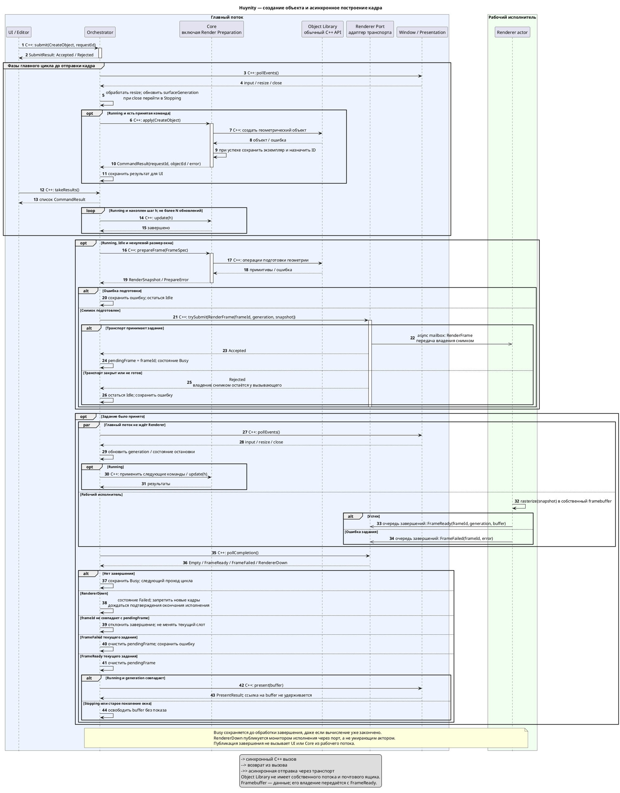

# UML взаимодействия подсистем Huynity

Диаграмма последовательности после [архитектурного ревью](architecture_review.md).
Показывает создание объекта и жизненный цикл асинхронного задания кадра.
Object Library представлена как участник синхронных вызовов в главном потоке,
а не актор. Renderer Port — адаптер транспорта и очереди завершений.

[Исходник PlantUML](subsystem_interaction.puml). Для отображения блока требуется
поддержка PlantUML в Markdown-просмотрщике. Локальный PlantUML не установлен;
SVG не сгенерирован, визуальная проверка не выполнена.

Синхронные вызовы показаны `->`, возвраты `-->`, асинхронные сообщения `->>`.
Фрагменты `alt`, `opt`, `loop` и `par` задают условия, повторения и конкурентное
выполнение. Главный цикл повторяется; после Empty порт опрашивается на следующем
проходе. Фрагмент `par` иллюстрирует перекрытие работы потоков и не вводит барьер:
главный поток не ждёт завершения растеризации.

